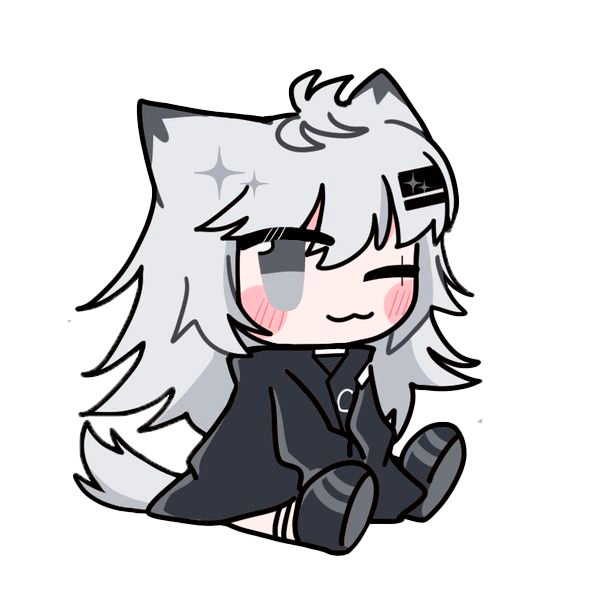
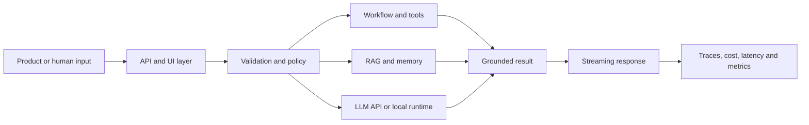

  

 

  

 

## Hey, I'm Vladyslav. I make models behave.

I’m an AI/ML Engineer building production-oriented LLM systems, agent platforms, RAG and memory pipelines, streaming APIs, observability tooling, and model inference infrastructure.

I care about the parts that remain after the demo works: strict schemas, durable state, tool safety, provider fallbacks, latency and token attribution, tests, deployment, and honest failure modes.

 

---

## Current hunt

- Building **agent platforms** with provider routing, MCP tools, durable workflow traces, memory, and guarded execution
- Developing **Rust-first inference tooling**, graph execution, planners, bounded model streaming, and CPU decode paths
- Shipping systems around **FastAPI**, **React/TypeScript**, **PostgreSQL**, **Redis**, **Qdrant**, **Kafka**, and **Docker**
- Designing **RAG and multimodal workflows** that know when to answer, clarify, escalate, or stay quiet
- Turning messy human requests into strict JSON, reproducible decisions, queues, metrics, and production logs

> [!NOTE]
> **Current R&D:** MAHT — an experimental Rust-based runtime and memory architecture for running models beyond a simple load-everything-into-VRAM pipeline.

---

## Core stack

  

---

## How I build systems

---

## Featured engineering work

<table>
<tr>
<td width="50%" valign="top">

<h3><a href="https://github.com/AegisRed/lattice-agent-platform">Lattice Agent Platform</a></h3>

Observable AI-agent platform with runtime OpenAI, Gemini, and DeepSeek routing, executable goal workflows, MCP tools, durable traces, multi-layer memory, and a complete Docker topology.

 

  

<a href="https://github.com/AegisRed/lattice-agent-platform"><b>Explore repository →</b></a>

</td>
<td width="50%" valign="top">

<h3><a href="https://github.com/AegisRed/Flowka">Flowka</a></h3>

Kafka observability platform with realtime cluster health, consumer lag, message inspection, historical metrics, and a live Producer → Topic → Consumer graph.

 

  

<a href="https://github.com/AegisRed/Flowka"><b>Explore repository →</b></a>

</td>
</tr>
<tr>
<td width="50%" valign="top">

<h3><a href="https://github.com/AegisRed/qa_guard_bot">QA Guard Bot</a></h3>

Telegram website monitor that runs deterministic Playwright checks first and uses Gemini only for bounded visual and semantic review, with scheduling, history, charts, and conservative alerts.

 

  

<a href="https://github.com/AegisRed/qa_guard_bot"><b>Explore repository →</b></a>

</td>
<td width="50%" valign="top">

<h3><a href="https://github.com/AegisRed/support_rag_bot">Support RAG Assistant</a></h3>

Grounded support triage with retrieval, server-side safety gates, audit logs, and explicit <code>answer</code>, <code>clarify</code>, or <code>handoff</code> decisions instead of confident guessing.

 

  

<a href="https://github.com/AegisRed/support_rag_bot"><b>Explore repository →</b></a>

</td>
</tr>
</table>

---

## More public work

| Project | What it demonstrates |
| --- | --- |
| [Lunaria Atelier](https://github.com/AegisRed/lunaria-patisserie) | FastAPI storefront, transactional SQLite orders, Docker/Nginx deployment, PWA and GitHub Pages demo |
| [Velora Travel](https://github.com/AegisRed/velora-travel) | React/TypeScript product UI, Express API, validation, tests, Docker and static fallback |
| [Travel Planner API](https://github.com/AegisRed/Test_task_Travel_Planning) | FastAPI, SQLAlchemy, external API validation, caching, business rules and pytest |
| [Daily Vibe Check](https://github.com/AegisRed/anvi_test_fullstack_task) | Compact React/Fastify CRUD product with tests and transparent mock analysis |
| [ODABA Gemini](https://github.com/AegisRed/odaba-gemini) | Responsive React/TypeScript Gemini workspace with streaming and local multi-chat state |
| [TGAI Chatbot](https://github.com/AegisRed/TGAI_chatbot) | Lightweight persona chatbot with persistent JSON memory and modular hooks |

Older coursework, game scripts, visual demos, and reference repositories remain public for history, but the projects above are the clearest representation of my current engineering level.

---

## What I like building

<table>
<tr>
<td width="50%" valign="top">

### Agent and LLM backends

Provider routing, durable workflows, tool execution, streaming output, retries, token accounting, strict schemas, and observable failure modes.

</td>
<td width="50%" valign="top">

### RAG and memory

Embeddings, semantic retrieval, long-term memory, grounded answers, confidence-aware escalation, and auditable decisions.

</td>
</tr>
<tr>
<td width="50%" valign="top">

### Runtime and infrastructure

Rust data planes, model streaming, CPU inference, Docker topologies, queues, caches, databases, and deployment tooling.

</td>
<td width="50%" valign="top">

### Product interfaces

React/TypeScript dashboards, realtime telemetry, admin tools, responsive layouts, and honest demo fallbacks.

</td>
</tr>
</table>

---

 

---

## Contact

  

