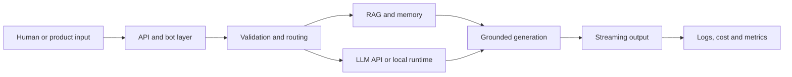

  

 

  

 

## Hey, I'm Vladyslav. I make models behave.

I’m an AI/ML Engineer building production LLM systems: backend orchestration, RAG and memory pipelines, multimodal services, streaming APIs, and GPU inference.

I care about the parts demos usually hide — failure modes, observability, latency, cost, strict contracts, and what happens when the model confidently does something stupid.

 

---

## Current hunt

- Building **Rust-first model runtimes**, graph execution, planners, and inference tooling
- Shipping AI systems around **FastAPI**, **LLM APIs**, **local inference**, **RAG**, and **semantic memory**
- Deploying models with **Docker**, **RunPod**, **Ollama**, **vLLM**, and OpenAI-compatible APIs
- Designing assistants with **long-term memory**, **streaming responses**, **usage analytics**, and **admin dashboards**
- Turning messy human requests into strict JSON, filters, queues, and production logs
- Slowly making private AI experiments safe enough to drag into the light

> [!NOTE]
> **Current R&D:** MAHT — an experimental Rust-based runtime and memory architecture for working with models beyond a simple load-everything-into-VRAM pipeline.

---

## Languages I actually touch

---

## Core stack

  

---

## How I build AI systems

---

## Featured repos

<table>
<tr>
<td width="50%" valign="top">

<h3><a href="https://github.com/AegisRed/qa_guard_bot">QA Guard Bot</a></h3>

Production-style Telegram bot for continuous website QA. Deterministic checks run first; Gemini is used only for narrow visual and semantic review.

 

  

<a href="https://github.com/AegisRed/qa_guard_bot"><b>Explore repository →</b></a>

</td>
<td width="50%" valign="top">

<h3><a href="https://github.com/AegisRed/support_rag_bot">Support RAG Assistant</a></h3>

Grounded first-line support triage with explicit <code>answer</code>, <code>clarify</code>, and <code>handoff</code> decisions instead of confident guessing.

 

  

<a href="https://github.com/AegisRed/support_rag_bot"><b>Explore repository →</b></a>

</td>
</tr>
<tr>
<td width="50%" valign="top">

<h3><a href="https://github.com/AegisRed/TGAI_chatbot">TGAI Chatbot</a></h3>

A lightweight persona chatbot with persistent memory, user profiling, modular memory hooks, and API-key rotation.

 

  

<a href="https://github.com/AegisRed/TGAI_chatbot"><b>Explore repository →</b></a>

</td>
<td width="50%" valign="top">

<h3><a href="https://github.com/AegisRed/odaba-gemini">ODABA Gemini</a></h3>

A responsive React and TypeScript AI workspace with streaming responses, multi-chat management, themes, search, and exports.

 

  

<a href="https://github.com/AegisRed/odaba-gemini"><b>Explore repository →</b></a>

</td>
</tr>
</table>

---

## Projects I like building

<table>
<tr>
<td width="50%" valign="top">

### AI backends

LLM orchestration, prompt routing, retry and fallback logic, token accounting, request queues, streaming output, and strict JSON schemas.

</td>
<td width="50%" valign="top">

### RAG & memory

Embeddings, semantic search, long-term memory, Qdrant and PostgreSQL retrieval, KB-grounded answers, and confidence-aware escalation.

</td>
</tr>
<tr>
<td width="50%" valign="top">

### Multimodal systems

Vision extraction, OCR and caption pipelines, image-context analysis, text-model reasoning, and aggregator APIs.

</td>
<td width="50%" valign="top">

### Telegram AI products

aiogram bots, subscriptions, payments, admin panels, moderation flows, roleplay systems, and analytics dashboards.

</td>
</tr>
</table>

---

 

---

## Contact

  

